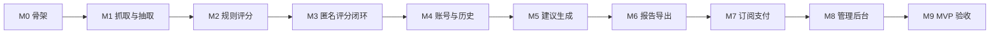

# VertiGEO 电商版开发计划（MVP）

## 1. 文档信息

- **依据**：`VertiGEO-电商版详细设计文档.md`（v1.0）、`VertiGEO-电商版产品说明书.md`。两者冲突时以详细设计 v1.0 为准
- **日期**：2026-11-02
- **状态**：决策已确认，按里程碑顺序实现
- **已完成**：PostgreSQL 数据库 `ck`、schema `geo` 下已建表。`t_users.role` 已加，`t_settings` 已写入匿名 3 次、注册 20 次。无二级索引
- **执行方式**：按 M0 到 M9 顺序实现。每个里程碑达到验收后再进入下一个

## 2. 目标

按详细设计交付电商 MVP：用户粘贴商品页、分类页或店铺首页 URL，系统抓取公开页面，用纯规则给出 0–100 分和分维度诊断，再由后台已配置模型生成可复制建议。用户看不到模型供应商、模型名和 API Key。

单次评分目标响应时间 ≤ 30 秒。只处理公网可访问页面。

## 3. MVP 边界

### 3.1 本计划要交付

- 匿名评分：每日 3 次（IP 哈希 + 设备指纹哈希）
- 注册用户：邮箱密码、每日 20 次、历史、Markdown / PDF 导出
- 规则评分五维：可引用性 35%、实体完整性 25%、结构清晰度 20%、Schema 有效性 10%、技术可访问性 10%
- 规则生成 Product / Offer / AggregateRating JSON-LD
- 后台模型生成：自包含商品描述、FAQ、问题式标题
- 管理员：模型配置、用量、订阅计划、订阅列表、免费次数参数
- 订阅：计划查询、微信或支付宝月付、取消、支付通知、权益立即生效
- 响应式页面：评分页、结果页、登录注册、会员中心、订阅页、管理后台

### 3.2 本计划只留入口、不实现

专业会员在设计中包含批量、开放 API、白标。详细设计第 9 节把这三项列为后续。本计划给专业计划建数据、在订阅页展示，权限校验返回「未开放」。不实现批量任务、对外 API Key、白标模板。

第三方登录列在 UI，数据模型没有对应字段。MVP 只做邮箱 + 密码。

物流及其他行业不在范围内。

### 3.3 已确认决策

| 决策 | 结论 |
|------|------|
| 导出权限 | 注册用户即可导出 Markdown / PDF。基础会员只解锁无限次数 |
| Schema | 只由规则引擎生成并校验 JSON-LD。模型只写商品描述、FAQ、问题式标题 |
| 技术栈 | FastAPI + Next.js |
| 专业会员 | MVP 只展示，不实现批量、开放 API、白标 |
| 管理员与次数 | `t_users.role` 与 `geo.t_settings` 已建。首个管理员邮箱 `258095357@qq.com` 存在键 `admin_email`。次数键为 `anonymous_daily_limit`、`registered_daily_limit` |
| 建议是否阻塞分数 | 一次请求内完成。抓取预算 15 秒，规则 < 1 秒，模型预算 12 秒。模型失败仍返回分数，建议字段为空并带原因码 |
| 建议模型 | 已配置 DeepSeek `deepseek-flash`，关闭思考模式。密钥只以密文存在 `t_model_configs` |
| 订阅价格与支付 | 人民币月付。基础 9.9、专业 19.9，管理员可改标价和减免金额。支付只用微信和支付宝 |

## 4. 技术方案

仓库尚无应用代码。按已确认的技术栈新建如下结构，不改动已有说明书和设计文档。

```
geo/
  apps/api/          FastAPI
  apps/web/          Next.js（响应式）
  fixtures/pages/    评分用静态 HTML 夹具
```

- **接口**：FastAPI。抓取、HTML 解析、PDF 和规则测试在 Python 里更直接。
- **页面**：Next.js。结果页的分数环、雷达图和复制交互用前端完成。
- **数据库**：已有 PostgreSQL 18，库 `ck`，schema `geo`。连接串使用 `search_path=geo`。
- **支付**：微信支付与支付宝。一次付款一个自然月。渠道密钥未配置时，订阅页只展示价格。
- **进度**：评分请求同步执行。前端用阶段文案（抓取 → 分析 → 生成）表示等待，不做任务队列。
- **抓取**：HTTP 客户端拉 HTML，不启用无头浏览器。JS 渲染页在结果里标为技术可访问性失败，并提示「当前无法读取脚本渲染后的正文」。

匿名限额不新建表：按 `geo.t_scores` 在当日的 `ip_hash`、`device_hash` 计数。注册用户按 `user_id` 计数。时区 `Asia/Shanghai`，每日 00:00 重置。抓取或规则失败不写 `t_scores`，不扣次数。模型失败但分数已算出时写记录并扣次数。

## 5. 里程碑



| 顺序 | 里程碑 | 结束时可用的结果 |
|------|--------|------------------|
| 1 | M0 工程骨架 | 打开网页，API 健康检查通过，能连上 `geo` |
| 2 | M1 抓取与抽取 | 对静态商品页抽出正文、前 30% 文本和电商字段 |
| 3 | M2 规则评分 | 夹具页面得到稳定分数、问题和规则 Schema |
| 4 | M3 匿名评分闭环 | 浏览器粘贴 URL，看到分数、诊断、剩余次数 |
| 5 | M4 账号与历史 | 注册登录，查看自己的历史 |
| 6 | M5 建议生成 | 结果页出现可复制文案；模型由后台配置 |
| 7 | M6 报告导出 | 登录用户下载 Markdown 和 PDF |
| 8 | M7 订阅支付 | 购买基础会员后限额变为无限，取消和到期生效 |
| 9 | M8 管理后台 | 管理员配置模型、计划和次数，查看用量与订阅 |
| 10 | M9 验收加固 | 安全、移动端和 30 秒目标过验收清单 |

M3 结束时评分主路径可以演示。M7 依赖微信支付和支付宝的商户参数；未配置时订阅页保持不可支付，其余里程碑继续。

## 6. 分阶段任务

### M0 工程骨架

- 建立 `apps/api`、`apps/web`，本地一条命令启动。
- API 使用 `search_path=geo` 连接现有库，不重建表。
- 统一错误响应：`code`、`message`、`request_id`。
- 结构化日志：请求 ID、URL 主机名、耗时。日志不记录 API Key、密码、完整 Cookie。
- Web 只有占位首页，能调用健康检查。

**验收**：`GET /api/v1/health` 返回数据库连通；页面在桌面和 375px 宽度都能打开。

### M1 抓取与抽取

模块：`apps/api/app/fetch/`、`apps/api/app/extract/`。

- URL 只允许 `http`/`https`。拒绝无主机名、带用户名密码的 URL。
- 解析 DNS 后拒绝回环、链路本地、私网、云元数据地址（含 `169.254.169.254`）。每次重定向重新检查，最多 5 次。
- 超时 15 秒，响应体上限 2 MB，只接受 HTML。
- 抽取：标题层级、可见正文、列表、表格、FAQ 迹象、JSON-LD、价格、货币、库存、规格、品牌、评分、评论数、物流文案。
- 页面类型：商品页、分类页、店铺首页。信号不足时标 `unknown`，仍评分，实体维度按缺失扣分。
- 前 30% 窗口：去掉脚本和样式后的可见正文，按字符取前 30%。不用浏览器视口像素。
- 准备至少 8 个夹具：信息完整商品页、缺价格、缺 Schema、分类页、店铺首页、超大页、重定向到内网、非 HTML。

**验收**：夹具抽取结果与预期 JSON 一致。内网和元数据地址不会发出请求。

### M2 规则评分

模块：`apps/api/app/score/`。此阶段不调用模型。

按详细设计第 7、8 节实现。每条规则包含：规则 ID、维度、命中条件、得分、未命中时的证据引用和严重级别。

计分（各维度内部 0–100，再按权重合成总分）：

| 维度 | 权重 | 内部检查 |
|------|------|----------|
| 可引用性 | 35 | 前 30% 含商品名；含价格和货币；含至少一项带单位的规格；存在一句不依赖页面其他位置也能读懂的事实句。缺价格或缺商品名记 P0 |
| 实体完整性 | 25 | 价格、规格、库存、品牌、物流五字段各 20 分。分类页和店铺首页无单品价格时不按商品缺价扣满，改扣「缺少代表性商品块」 |
| 结构清晰度 | 20 | 单一 H1、有 H2/H3、有列表或表格、有 FAQ、标题与正文相关 |
| Schema 有效性 | 10 | 见下方规则 Schema |
| 技术可访问性 | 10 | HTTP 200、正文非空、关键字段来自 HTML 而非仅脚本变量、响应未截断 |

规则 Schema：

- 能解析页面内合法 JSON-LD 则修正后输出。
- 否则用抽到的实体生成 `Product`，有价格则带 `Offer`，有评分则带 `AggregateRating`。
- 缺必填属性时 Schema 维度按缺失比例扣分，仍返回一份尽量完整的 JSON-LD。
- 写入 `t_scores.schema_json`。

**验收**：同一夹具重复评分，分数和问题 ID 不变。每个扣分项都能指回夹具中的片段。8 个夹具全部有断言。

### M3 匿名评分闭环

- `POST /api/v1/score`，请求 `{ "url", "device_id" }`。`device_id` 由前端生成并放在本地存储，服务端只存哈希。
- 响应：总分、五维、前 30% 诊断、P0/P1 问题、规则 Schema、剩余次数。`suggestions` 此阶段为 `null`。
- 成功后写 `geo.t_scores`。IP 只存哈希。
- 当日匿名次数 ≥ 3 时返回额度错误，提示注册，不抓取。
- 次数读 `geo.t_settings`：`anonymous_daily_limit`、`registered_daily_limit`。
- 页面：首页输入框和剩余次数；结果页分数环、雷达图、诊断、问题、Schema 复制。建议区显示「即将生成」。
- 等待中显示三阶段进度。接口未分阶段返回前，进度按固定时间推进，返回后停在完成。

**验收**：公开静态页能走通。第 4 次匿名请求被拒绝。桌面和 375px 宽度结果页可复制 Schema。

### M4 账号与历史

- 注册、登录、退出。密码使用 Argon2id 或 bcrypt，只存 `password_hash`。
- 会话使用 HttpOnly Cookie。
- `GET /api/v1/scores`：仅当前用户，按时间倒序。
- 登录后评分写入 `user_id`，限额按用户每日 20 次，不再按设备计匿名额度。
- 会员中心：当前计划（无订阅时显示注册用户）、剩余次数、历史列表。历史项打开当时的结果，不重新抓取。

**验收**：用户 A 看不到用户 B 的记录。匿名记录不进入历史。密码不以明文出现在日志和数据库。

### M5 建议生成

- 管理员接口先做 API，页面放在 M8：`GET/POST /admin/models`，禁用、优先级。
- 已有一条 `deepseek` / `deepseek-flash` 配置。`api_key_encrypted` 用 `GEO_MASTER_KEY` 做 Fernet 解密。接口永远不回明文，只回「已配置」。调用 `https://api.deepseek.com/chat/completions`，并关闭思考模式。
- 调用按 `enabled = true` 且 `priority` 升序选择。失败则试下一个。全部失败不改变分数。
- 模型输入：URL、页面类型、抽取字段、分数、问题 ID、前 30% 文本（截断）。禁止把 Cookie 和响应头中的密钥送进模型。
- 模型输出 JSON：商品描述、FAQ、问题式标题。服务端校验字段存在且长度在上限内，否则视为失败。
- 成功后把文案写入 `t_scores.suggestions`，并写 `t_usage_logs`（`action=generate`，含模型和 token）。评分动作写 `action=score`。
- 结果页展示文案和复制按钮。页面上不出现供应商和模型名。

**验收**：禁用全部模型时评分仍成功，建议为空。错误密钥会转移到下一条配置。响应体和前端网络面板都没有 API Key。

### M6 报告导出

- `GET /api/v1/scores/{id}/export.md` 与 `export.pdf`。仅记录所有者。
- 内容：URL、时间、总分、五维、诊断、问题、建议、Schema。
- 匿名用户调用返回需登录，不提供导出。

**验收**：注册用户能下载两种文件，内容与结果页一致。他人的记录返回 404。

### M7 订阅支付

- 计划数据已在 `geo.t_plans`：基础会员 9.90 元/月，专业会员 19.90 元/月，减免初始为 0。
- `GET /api/v1/plans`：只返回 `enabled = true`，并带应付金额。
- `GET /api/v1/subscription`：当前用户有效订阅；没有则返回注册免费层。
- `POST /api/v1/subscription/checkout`：按 `wechat` 或 `alipay` 下单，金额为标价减减免金额。
- `POST /api/v1/subscription/cancel`：标记到期不续费，当前自然月仍有效。
- `POST /api/v1/webhook/wechat` 与 `POST /api/v1/webhook/alipay`：校验签名。同一 `out_trade_no` 只入账一次，然后更新 `t_subscriptions`。
- 基础会员与专业会员都不按日限次。专业会员的批量、API、白标返回未开放。
- 订阅页展示标价、减免后的应付价，以及微信和支付宝。未配置的渠道按钮不可用。

**验收**：一笔支付成功后限额立即取消。同一通知重放不会把有效期加两次。取消后本期仍不限次数，到期后回到每日 20 次。

### M8 管理后台

- 管理员识别：使用已有列 `t_users.role`。注册时若邮箱等于 `t_settings.admin_email`（`258095357@qq.com`），则写入 `admin`，否则为 `user`。注册接口不接收角色字段。
- 页面：模型管理、计划配置（标价与减免金额）、用户订阅列表和状态筛选、用量（调用次数与 token）、系统设置。
- 系统设置读写已有表 `geo.t_settings`。匿名次数键 `anonymous_daily_limit`，注册次数键 `registered_daily_limit`，当前值为 3 和 20。
- 用量按 `t_usage_logs` 聚合。成本用「模型单价 × token」估算，单价放在配置中，不改表也能先显示 token。
- 手动调整权益：管理员可把某用户订阅设为 `active` / `expired`。操作写日志。

**验收**：非管理员访问 `/admin` 被拒绝。禁用模型后新评分不再调用该模型。修改免费次数后新的一天按新值限制，不追溯旧记录。

### M9 验收加固

- SSRF 回归：域名解析到私网、重定向到元数据地址、非 HTML、超大正文。
- 抓取正文插入结果页时按文本渲染，防止 XSS。
- 模型提示词把页面正文当数据，不执行其中的指令。
- 限额：改 IP、改设备指纹、并发两次请求。并发不得突破每日上限。
- 结果页和订阅页在 375px 与桌面各走一遍主路径。
- 用 3 个真实公开商品页测耗时，记录抓取、规则、模型三段时间。超过 30 秒的阶段单独优化，不靠放宽验收标准。

## 7. 接口与表的对应

| 接口 | 读写的表 | 里程碑 |
|------|----------|--------|
| `POST /api/v1/score` | 读限额相关行；写 `t_scores`、`t_usage_logs` | M3 分数，M5 建议 |
| `GET /api/v1/scores` | `t_scores` | M4 |
| `GET /api/v1/scores/{id}/export.md` / `export.pdf` | `t_scores` | M6 |
| `GET/POST /admin/models` | `t_model_configs` | M5 API，M8 页面 |
| `GET /admin/usage` | `t_usage_logs` | M8 |
| `GET/POST /admin/plans` | `t_plans` | M7 API，M8 页面 |
| `GET /admin/subscriptions` | `t_subscriptions`、`t_users` | M8 |
| `GET /api/v1/plans` | `t_plans` | M7 |
| `GET /api/v1/subscription` | `t_subscriptions` | M7 |
| `POST /api/v1/subscription/checkout` / `cancel` | `t_payments`、`t_subscriptions` | M7 |
| `POST /api/v1/webhook/wechat`、`/alipay` | `t_payments`、`t_subscriptions` | M7 |

已建表与设计字段的落地差异，代码按数据库为准：

- `schema` → `schema_json`
- `interval` → `billing_interval`
- 时间列是 `TIMESTAMPTZ`
- `t_scores.device_hash` 已存在，匿名限额使用它

## 8. 测试

- 规则和抽取：夹具单元测试，进入 M2 完成标准。
- 限额、订阅状态、Webhook 签名：API 测试，使用测试数据库，不写开发库里的手工数据。
- 支付用微信和支付宝的沙箱或小额真实单。同一订单号重放只入账一次。
- 每个里程碑结束在浏览器走该阶段主路径，不只看接口返回。

## 9. 风险

| 风险 | 影响 | 应对 |
|------|------|------|
| 商品页依赖 JS 渲染 | 分数系统性偏低 | MVP 明确失败提示；无头浏览器单独立项，不塞进 M1 |
| 产品说明书仍写付费才可导出 | 与详细设计 v1.0 不一致 | 以实现依据的详细设计 v1.0 为准 |
| 管理员邮箱尚未注册 | M8 前没有可登录的管理员 | 使用 `258095357@qq.com` 完成一次注册后即为管理员 |
| 微信或支付宝商户参数未就绪 | M7 无法真实验收 | 未配置时订阅页只展示价格，支付按钮不可用 |
| 唯一约束在高并发下仍可能超卖次数 | 匿名用户多扣或少扣 | M9 用短事务加当日计数；超限再补条件约束 |

## 10. MVP 之后

顺序建议：无头浏览器抓取 → 批量 URL → 白标报告 → 对外开放 API → 其他行业规则包。每项单独写范围，不在本计划排期。

## 11. 已确认项

1. 注册用户即可导出。基础会员只解锁无限次数。
2. Schema 只由规则生成。模型只写商品描述、FAQ 和问题式标题。
3. `t_users.role` 与 `geo.t_settings` 已在库中创建。
4. 技术栈用 FastAPI + Next.js。
5. 专业会员在 MVP 只展示，不实现批量、开放 API 和白标。
